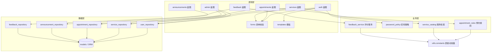

# 模块结构图与耦合分析

> 对应《软件构造》实验二：模块化软件构造

## 1. 功能分解（自顶向下）

按"高内聚、低耦合"原则，把便民服务软件分解为 6 个业务模块 + 3 个支撑层：

```
便民服务平台
├── 用户管理模块 auth      注册 / 登录 / 退出 / 个人信息修改
├── 服务查询模块 services  分类浏览 / 关键词搜索 / 详情查看
├── 在线预约模块 appointments 选服务 / 填信息 / 提交 / 取消 / 查我的预约
├── 公告资讯模块 announcements 列表 / 详情 / 关键词搜索
├── 反馈评价模块 feedback  提交评价 / 查看历史评价
└── 后台管理模块 admin     服务管理 / 用户管理 / 预约管理
支撑层：services（业务规则）· repositories（数据访问）· utils（常量与工具）
```

## 2. 模块结构图（分层 + 调用方向）



**调用规则（单向依赖）**：表现层 → 业务层 → 数据层，禁止反向调用；
业务层不 import 数据层实现（数据由表现层/服务编排层注入），因此业务规则可脱离数据库测试。

## 3. 模块间依赖关系与耦合类型分析

| 依赖方 → 被依赖方 | 传递的内容 | 耦合类型 | 强度 | 说明 |
| --- | --- | --- | --- | --- |
| 表现层(蓝图) → 业务层(services) | 普通参数与返回值（日期、容量、状态字符串） | **数据耦合** | 弱 ✅ | 最理想的耦合形式，接口只传必要数据 |
| 业务层 → utils.constants | 只读常量表 | **公共（共享）耦合** | 弱 ✅ | 常量集中管理，避免魔法值扩散 |
| 表现层 → 数据层(repositories) | 查询条件与模型对象 | **数据耦合 + 标记耦合** | 中 | 传递模型对象会降低独立性，已通过 repository 封装收敛 |
| 服务编排 → 业务规则 | `AppointmentContext` 数据对象 | **数据耦合** | 弱 ✅ | 以数据对象代替"多参数"，减少接口宽度 |
| 数据层 → models/ORM | SQLAlchemy 会话 | **外部耦合** | 中 | 受框架约束，但被 repository 隔离，业务层无感 |
| 蓝图 → 蓝图 | 无直接调用（跨模块通过 url_for 跳转） | **无直接耦合** | 无 ✅ | 模块间仅靠 URL 与数据库协作 |
| 任意模块 → 另一模块内部变量 | — | **内容耦合** | — | **不存在**（禁止跨模块改内部状态） |

### 判定结论
1. **强依赖**：在线预约模块 → 用户管理模块（必须取登录态）与 → 服务查询模块（必须取服务信息）；
   这两处通过"参数传值"实现，属数据耦合，强度可接受。
2. **弱依赖**：公告资讯、反馈评价与其余模块之间只共享用户 id，可独立演化。
3. 已消除的控制耦合：原设计中"是否需要校验容量"由调用方传布尔开关控制（控制耦合），
   改为业务规则内部依据 `AppointmentContext` 自行判断，降级为数据耦合。
4. 内聚性：每个模块内部只完成一类职责（如 password_policy 只做口令规则），属**功能内聚**（最高等级）。

## 4. 模块化收益（本项目的实际体现）

- 预约规则模块 33 条用例**零数据库依赖**，单次运行 < 1 秒；
- 新增一个服务分类只需在 `utils/constants.py` 的表中加一行，无需改动任何判断语句；
- 后台管理与前台预约复用同一套 `appointment_rules`，规则不会两处漂移。
