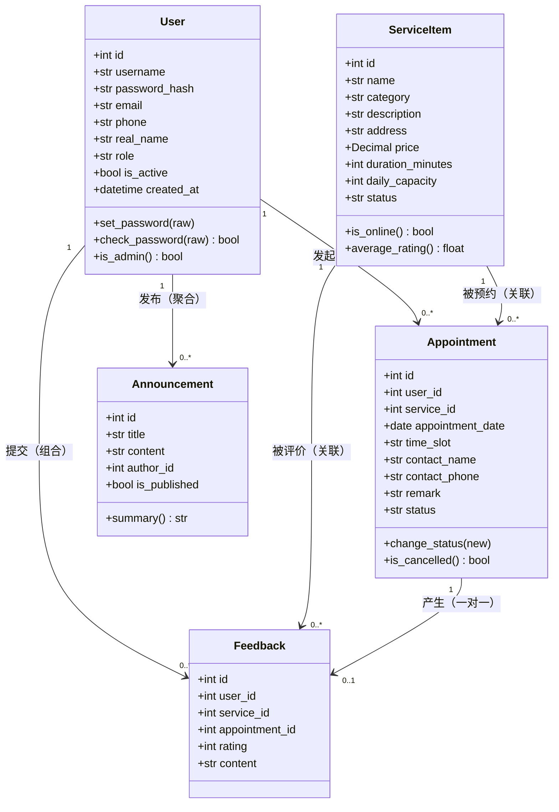

# 领域模型与契约式设计

> 对应《软件构造》实验三：面向对象的软件构造

## 1. 核心领域对象识别

从用户故事与业务流程中识别出 5 个核心领域对象：

| 领域对象 | 说明 | 主要职责 |
| --- | --- | --- |
| `User` 用户 | 系统的使用者，分普通用户/管理员 | 认证、角色判定、个人信息维护 |
| `ServiceItem` 服务项目 | 可被预约的便民服务事项 | 服务信息维护、上下架、评分统计 |
| `Appointment` 预约记录 | 用户与某一服务在某一时段的约定 | 状态流转、取消、与评价关联 |
| `Announcement` 公告 | 面向全体用户的通知 | 发布、检索 |
| `Feedback` 反馈评价 | 用户对已完成服务的评价 | 评分与文本、与服务/预约关联 |

## 2. 类模型图

## 3. 类关系说明

| 关系 | 双方 | 类型 | 理由 |
| --- | --- | --- | --- |
| User — Appointment | 1 : N | **组合** | 预约不能脱离用户存在；删除用户时其预约级联删除（`cascade="all, delete-orphan"`） |
| User — Feedback | 1 : N | **组合** | 评价必须依附于用户，同上级联删除 |
| ServiceItem — Appointment | 1 : N | **关联** | 服务与预约相互独立引用，服务下架后历史预约仍保留（外键保障可追溯） |
| Appointment — Feedback | 1 : 0..1 | **组合/一对一** | 一条预约最多产生一条评价（`appointment_id` 唯一约束） |
| User — Announcement | 1 : N | **聚合** | 公告可脱离作者独立存在（作者账号删除后公告仍保留，`author_id` 可空） |
| User — Flask `UserMixin` | 继承 | **泛化** | 复用 `is_authenticated` 等认证接口，避免重复实现 |

## 4. 契约式设计（Design by Contract）

对每个关键方法明确**前置条件（Pre）／后置条件（Post）／不变量（Inv）**，并在代码中以断言式注释、参数校验与返回值约定体现。

| 方法 | 前置条件 | 后置条件 | 不变量 |
| --- | --- | --- | --- |
| `User.set_password(raw)` | raw 为非空字符串 | 生成哈希写入 `password_hash` | **明文密码永不落库**；`password_hash` 非空 |
| `User.check_password(raw)` | 对象已持久化 | 返回 bool | 不抛异常；比较恒定时间（werkzeug 实现） |
| `Appointment.change_status(new)` | 调用方已用 `can_transition` 校验通过 | 状态更新，`updated_at` 刷新 | `status` 始终 ∈ 状态表 |
| `validate_new_appointment(ctx, d, slot, today)` | ctx 为 `AppointmentContext`；d 为 `date` | 返回错误列表，空列表=通过 | 不修改入参、不写库、不抛异常 |
| `remaining_capacity(cap, used)` | cap ≥ 0，used ≥ 0 | 返回剩余名额 | 返回值恒 ≥ 0（即使超卖也不为负） |
| `can_transition(cur, new)` | 任意字符串 | 返回 bool | 未知状态一律返回 False（安全默认） |
| `UserRepository.create(...)` | username/email 未被占用 | 返回已持久化的 User（含 id） | 用户名、邮箱唯一 |
| `create_appointment(...)` | user 已登录且激活 | 成功返回 (appointment, [])；失败返回 (None, 错误列表) | **失败路径绝不写库** |
| `cancel_appointment(appt, op)` | appt 存在 | 返回 (bool, 提示) | 仅本人或管理员可取消；终态不可取消 |
| `FeedbackRepository.create(...)` | rating ∈ [1,5]，预约未评价 | 返回 Feedback | 一条预约至多一条评价 |

### 契约在代码中的体现方式
1. **数据库层**：用 `CheckConstraint` 把"状态合法""评分 1–5""容量 > 0"等不变量交给数据库强制执行；
2. **领域层**：`change_status` 只负责赋值，合法性由状态机表判定，避免非法中间态；
3. **服务层**：`create_appointment` 先校验后写库，保证"失败即无副作用"；
4. **文档层**：契约写在本表，并在方法 docstring 中以"前置条件/后置条件/不变量"三段注明。

## 5. 表驱动编程的应用

| 场景 | 改造前（if/elif） | 改造后（查表） |
| --- | --- | --- |
| 预约状态流转 | `if status=='pending': ... elif status=='confirmed': ...` | `APPOINTMENT_TRANSITIONS[cur]` 集合查表，O(1) |
| 服务分类显示 | 每个页面写 `if category=='government': '政务服务'` | `SERVICE_CATEGORIES` 字典 + `category_text()` |
| 状态中文文案 | 多处 `if` 判断 | `APPOINTMENT_STATUS_TEXT` + `status_text()` |
| 服务排序方式 | 视图中按参数分支构造 `order_by` | `SORT_EXPRESSIONS` 字典映射排序表达式 |
| 评价星级文案 | 模板里判断 1–5 | `RATING_TEXT` 字典 |

收益：新增一个状态或分类，只需在 constants 中加一行，无需修改任何判断逻辑（对扩展开放、对修改关闭）。
