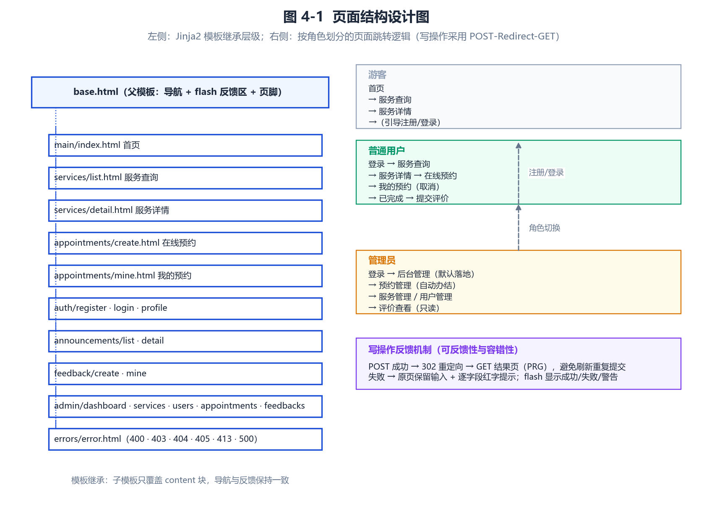

# 用户交互设计说明

> 对应《软件构造》实验四：用户交互的软件构造

## 1. 用户角色与典型场景

| 角色 | 典型场景 | 核心操作流程 |
| --- | --- | --- |
| 游客 | 了解平台、查找服务 | 首页 → 服务查询（分类/关键词） → 服务详情 →（被引导注册/登录） |
| 普通用户 | 办理业务 | 注册 → 登录 → 服务查询 → 服务详情 → 在线预约 → 我的预约（查看/取消）→ 评价 |
| 普通用户 | 了解通知 | 首页 → 公告资讯 → 公告详情 → 关键词搜索 |
| 管理员 | 维护服务目录 | 登录 → 后台概览 → 服务管理 → 新增/编辑/上下架 |
| 管理员 | 处理预约 | 登录 → 预约管理 → 按状态筛选 → 推进状态（确认/完成） |
| 管理员 | 运营维护 | 用户管理（禁用异常账号）、发布公告 |

## 2. 页面结构（层级与跳转）

> **课本依据**：教材 5.1 讨论「多个功能的组织与呈现」，5.3 给出交互设计的基本过程与快速原型法。
> 按此绘制的页面结构设计图如下，已嵌入《软件构造实验四》报告图 4-1。



```
base.html（父模板：头部导航 + 反馈区 + 页脚）
├── main/index.html        首页：热门服务 + 最新公告
│   ├── services/list.html    服务查询（搜索/分类/排序/分页）
│   │   └── services/detail.html  服务详情（简介 + 时段余量 + 评价）
│   │       └── appointments/create.html  在线预约表单
│   │           └── appointments/mine.html  我的预约（取消）
│   ├── announcements/list.html  公告列表
│   │   └── announcements/detail.html  公告详情
│   ├── auth/register.html / login.html / profile.html
│   ├── feedback/create.html / mine.html
│   └── admin/
│       ├── dashboard.html      运营概览（统计卡片）
│       ├── services.html / service_form.html
│       ├── users.html
│       ├── appointments.html
│       ├── feedbacks.html      只读评价查看
│       ├── audit_logs.html     只读审计日志（2026-11-24）
│       └── announcement_form.html
└── errors/error.html（统一错误页：400 / 403 / 404 / 405 / 413 / 500）
```

**跳转逻辑**：写操作（表单提交）成功后一律重定向到结果页（POST-Redirect-GET），
避免刷新导致重复提交；失败则在当前页保留输入并逐字段显示错误。

## 3. 交互设计原则的落地

| 原则 | 实现 |
| --- | --- |
| 一致性 | 所有页面继承 `base.html`，导航、按钮样式、提示条位置统一；表单渲染统一走 `_macros.html` 宏 |
| 简洁性 | 列表页每页 9 条，卡片只展示关键字段，详情才展开完整信息 |
| 可反馈性 | 每个写操作都有 `flash` 提示（成功/失败/警告）；表单错误逐字段显示；提交按钮显示"提交中，请稍候…"加载态并禁用防重复提交 |
| 容错性 | 关键操作（取消预约、服务上下架、用户启停）弹出确认框（`data-confirm` + `app.js`，兼容 CSP）；错误输入保留原值 |
| 可控性 | 详情/表单页提供返回入口；未登录跳转登录页后能回到原目标页（`next` 参数，且只接受站内相对路径） |

## 4. 表单处理

| 表单 | 字段 | 校验规则 | 错误呈现 |
| --- | --- | --- | --- |
| 注册 | 用户名/邮箱/手机号/姓名/密码/确认密码 | 用户名 3–20 且唯一、邮箱格式且唯一、手机号 11 位、密码 8–20 位含字母与数字、两次输入一致 | 字段下方红字 + 顶部提示条 |
| 登录 | 用户名或邮箱/密码/记住我 | 必填；账号密码错误统一提示（不区分是否存在该用户） | 顶部提示条 |
| 预约 | 日期/时段/联系人/电话/备注 | 日期必填且为合法日期、时段必须在开放时段表内、联系人 ≥2 字、电话 11 位 | 字段下方红字 |
| 评价 | 预约/评分/内容 | 预约必须属于本人且已完成未评价、评分 1–5、内容 ≤300 字 | 字段下方红字 |
| 服务维护 | 名称/分类/价格/容量等 | 名称必填且唯一、价格 ≥0、容量 ≥1 | 字段下方红字 |

所有表单均由 Flask-WTF 提供 **CSRF 令牌**（`{{ form.hidden_tag() }}`），
服务端由 `CSRFProtect` 全局校验 POST 请求（测试环境下关闭以便自动化）。

### 4.1 预约表单的可用性优化（2026-11-24）

- 姓名、电话从个人资料**预填**，用户只需核对/修改；
- 日期设置 `min=今天`、`max=今天+30`，浏览器层面阻止过去/超窗日期；
- 默认日期选择“今天还有可约时段则今天，否则明天”，默认时段选第一个未过且未满的时段；
- 服务详情页在“今日已无可约时段”时显示提示，主按钮改为“选择其它日期”；
- 搜索/筛选输入框增加读屏标签（`sr-only`），搜索栏在桌面端改为单行布局；
- 取消预约、服务上下架、用户启停增加确认框，降低误触风险。

## 5. 会话与权限管理

- **登录状态**：`Flask-Login` + `login_user/logout_user`，`user_loader` 从数据库加载用户；
- **访问控制**：`@login_required` 保护需登录视图；未登录访问自动跳转 `?next=原地址`；
- **角色控制**：`admin_required` 装饰器校验 `is_admin`，非管理员返回 403；
  后台蓝图用 `before_request` 统一守卫，避免逐视图漏加；
- **会话有效期**：`REMEMBER_COOKIE_DURATION = 3600` 秒；
- **安全细节**：登录失败提示统一、跳转地址只接受站内相对路径（防开放重定向）、密码哈希存储。

### 5.1 忘记密码：管理员后台重置（2026-11-24）

课程实验不接邮件/短信，采用“管理员核实身份 → 后台重置”的低成本方案：

1. 用户在「用户管理」列表点「重置密码」；
2. 管理员输入两次临时密码（复用注册密码策略）；
3. 系统更新哈希并写审计日志 `user.reset_password`；
4. 管理员通过可靠渠道告知用户，用户登录后到「个人中心」修改。

约束与取舍：

- 仅允许重置**普通用户**；管理员账号通过个人中心或 CLI 维护；
- 管理员看不到原密码，系统不展示/不存储明文；
- 不强制下次登录改密（课程简化），依赖页面提示和用户自觉；
- 已登录会话不会因重置立即失效，这是课程级的已知简化，生产环境应增加会话版本/强制改密。

角色与功能的完整对照见 `docs/17-角色与功能一致性矩阵.md`。

## 6. 集成与交互测试结果

```
$ pytest tests/integration
.................................        [100%]
33 passed
```

集成测试覆盖注册、登录与会话、访问控制、预约表单、取消预约、服务/公告页面、
后台管理 7 类交互；另有功能层的账号资料、错误页、后台服务管理等用例，
当前全量 580 条（unit 357 / functional 140 / integration 33 / system 50）全部通过。
